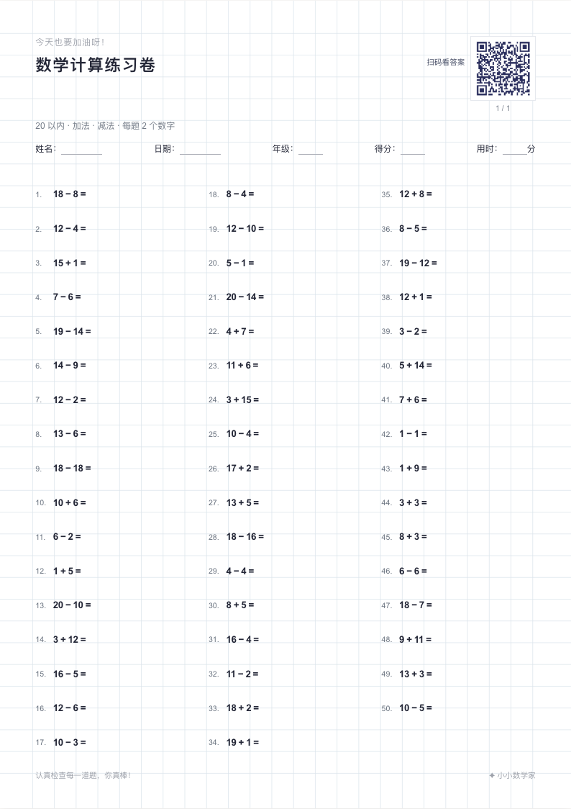
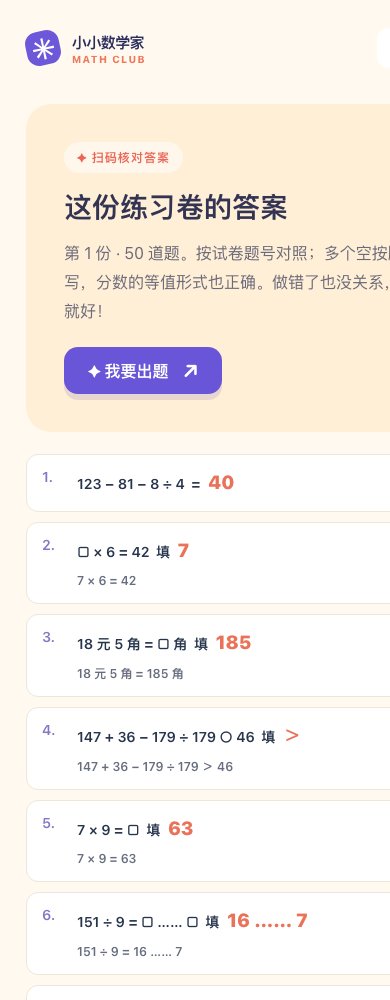

# 小小数学家 · 数学计算练习卷生成器

## 项目介绍

给孩子准备每天的数学练习，不必再手写出题。打开网页，选好题型、难度和纸张样式，就能在浏览器中随机生成试卷、预览并打印。项目不需要账号或后端，题目在本地浏览器生成，适合部署到 GitHub Pages。

### 可以做什么

- **按需要出题**：选择每份 50 或 100 题；数字范围有 5、10、20、50、100、200 以内，也可以自定义 2～200 的整数上限。
- **一键选择难度**：提供幼小衔接、一年级上、一年级下和二年级的保守预设，自动配置数字范围与运算方式；应用后仍可继续修改为自己的设置。
- **选择计算方式**：加、减、乘、除可多选，口算和缺项每题可使用 2、3 或 4 个数字；多数字算式不带括号，并遵循先乘除、后加减的常规顺序。加法可选择随机、不进位或必须进位，减法可选择随机、不退位或必须退位，多数字题的每一步都会遵守设置。一年级默认是 20 以内的两数字加减题。普通整数题的数字、中间结果和答案均在选定范围内且非负；普通除法只出能整除的题。
- **多种专项练习**：口算、随机缺项填空、数字或算式比较大小、填运算符、2～9 口诀的乘法/除法/缺项正反练习、加减乘除竖式、有余数除法。缺项保证有唯一的合法答案，运算符题避免歧义。
- **生活与拓展数学**：整点、半点与经过时间，元角分和长度/质量单位双向换算，同分母分数和一位小数加减。口诀固定为 2～9（乘积不超过 81）；人民币在 20 元以内，换算后最多 2000 分；单位换算最多 9 个大单位（换算后最多 9000 小单位）；分数分母为 2～9、结果在 0～1。以上专项使用自己的范围，不套用基础计算的整数上限；一位小数仍使用选定上限。
- **混合组卷**：题型可跨标签多选，在每份总题量中尽量均匀分配后随机打乱；也可只保留一种专项。设置区分成“基础计算、题型专项、生活数学、打印设置”，不必一次查看所有功能。
- **一次制作多份**：50 题模式可生成 1～10 份题目不同的试卷，而不是把同一张纸复印多次；100 题模式固定为一份。当题目条件过窄、无法保证多份不同的时候，网页会提示调整设置。
- **选择整页底纹**：清爽白纸、数学方格、横线、点阵、田字格。底纹覆盖整张试卷，而不是只加在等号后面；屏幕预览与打印版式对应。
- **按 A4 打印**：每张试卷纸 50 题，顶部留有姓名、日期、年级、得分和用时的填写位置，第一行题目与页眉分隔线留有间距。两数字短口算用三列，较长或混合题用两列；纯竖式页面采用五列十行紧凑版，混合卷中的竖式进一步压缩，书写空间有限，复杂演算可另用草稿纸。100 题分成两张 A4；可以选择为**每份**试卷再加印一张答案 A4，多空、分数和商/余数答案也集中在这一张。
- **扫码核对答案**：每张试卷右上角都有专属二维码，左侧标注“扫码看答案”，页码在二维码下方。手机扫码可在网页查看**这一份试卷**的算式与答案，答案紧跟对应算式；较长的算式在电脑上使用更宽的卡片。答案页有“我要出题”按钮，可以直接回到出题首页。

### 使用方法

1. 默认打开 **基础计算**，可以先选年级预设，再调整数字范围、运算方式、进退位和数字个数。
2. 到 **题型专项** 或 **生活数学** 选择需要的题型；在“已选题型”中点 × 可取消不需要的题型，但至少保留一种。选“九九口诀”后可指定口诀段。跨标签选择会保留，多选会均匀混合。
3. 到 **打印设置** 选择 50 / 100 题、底纹和答案页；50 题还可指定 1～10 份。切换标签和底纹不会改变已有题目；点击 **生成新试卷** 可随机换一套。
4. 点击 **打印试卷**，打印对话框中选 **A4、100% 缩放**，关闭浏览器自带页眉页脚。建议先检查页数和竖式空间；手机系统与打印机可能有各自的默认页边距。
5. 完成练习后扫描二维码核对对应试卷答案。多个空按顺序填写，分数可填等值形式；不打印答案页也能扫码查看。网址只携带版本、设置和随机种子，不上传或保存题目、答案；以前打印的 v1～v3 二维码仍可还原原卷。

### 页面预览

**选题与试卷预览**

**数学方格底纹的 A4 试卷**（图中二维码仅作界面展示，实际打印时每份试卷的二维码都不同）

**手机扫码后的答案页**

本站地址：[**https://math.svenshen.me/**](https://math.svenshen.me/)。GitHub Pages 已部署并启用强制 HTTPS，Cloudflare 以 DNS only 模式将子域名指向 GitHub Pages。

## Fork 后如何部署

本仓库自带 GitHub Actions 部署工作流，构建产物使用相对路径；无论 Fork 是否改名，都不需要手动修改代码中的仓库路径。

1. 点击仓库右上角的 **Fork**，将项目复制到自己的 GitHub 账号。建议保持默认分支为 `main`。
2. 进入你自己的仓库 **Actions** 页面；如果 GitHub 提示工作流被禁用，先按提示启用。
3. 进入 **Settings → Pages**，把 **Build and deployment → Source** 设置为 **GitHub Actions**。
4. 在 **Actions → Deploy to GitHub Pages** 中点击 **Run workflow**，选择 `main` 并运行。等待 `build-and-deploy` 显示成功。以后每次推送到 `main` 也会自动重新部署。
5. 回到 **Settings → Pages** 查看网站地址。仓库名不变时通常是 `https://<你的用户名>.github.io/math-worksheet-generator/`。打开网址检查出题、打印预览和二维码答案页。

### 可选：绑定自己的子域名

1. **先**在 Fork 仓库的 **Settings → Pages → Custom domain** 中输入并保存你自己的子域名；不要使用本站的 `math.svenshen.me`。
2. 再到 DNS 服务商添加 `CNAME`：记录名为你的子域名前缀，目标为 `<你的用户名>.github.io`，**不要加仓库名或 `https://`**。使用 Cloudflare 时先选择 **DNS only（灰色云朵）**，TTL 可设为 Auto。
3. 等待 DNS 解析和 GitHub Pages 自动签发的 HTTPS 证书生效，然后在 Pages 设置中开启 **Enforce HTTPS**。从自定义域名打开网页时，试卷二维码会自动使用该域名。

如果工作流没有出现，先确认 Fork 的 Actions 已启用；如果工作流成功但网站打不开，检查 Pages 来源、DNS 记录和证书状态。此 GitHub Actions 工作流不需要在仓库中放置 `CNAME` 文件。
